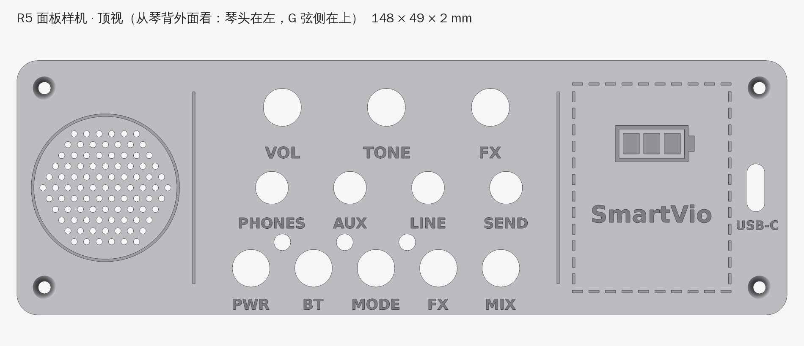
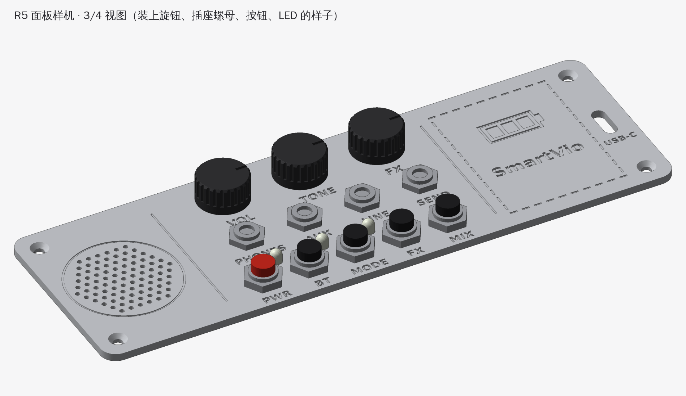

# SmartVio R5 面板 1:1 样机

这是 R5 上盖面板的 1:1 样机。
目的：在正式出图前，先在真琴上试旋钮、按键、插孔好不好够。
这不是正式图纸。尺寸来自已确认的 R5 布局。




## 1. 文件

| 文件 | 用途 |
|---|---|
| `template_1to1.pdf` | A4 纸模板，1:1。先打印这个，在琴上比一比。 |
| `template_1to1.svg` | 同一张模板的矢量文件（210 × 297 mm），方便改图。打印请用 PDF。 |
| `cover_plate.stl` | 面板，拿去 3D 打印。已经是打印方向（顶面朝上）。 |
| `knob.stl` | 旋钮帽，打印 3 个。已经倒放（顶面贴床）。 |
| `cover_plate.step` / `knob.step` | CAD 文件，给后面出正式图用。 |
| `preview_top.png` / `preview_34.png` / `preview_knob.png` | 预览图。 |
| `build_mockup.py` | 生成以上全部文件的脚本。尺寸参数都在文件开头。 |

## 2. 先打印纸模板

1. 用 A4 纸打印 `template_1to1.pdf`。选「实际大小」或 100%。不要选「适合页面」。
2. 用尺量模板上的红色比例尺。应该正好 50 mm。差超过 0.5 mm，就改打印设置再打。
3. 模板是从琴背外面看的样子：琴头在左，G 弦侧在上。
4. 沿蓝色外框剪下，贴到琴背上看位置（贴法见第 6 节）。
5. 孔心画了十字。可以用针扎孔心，在美纹纸上做记号。

模板 1:1 是这样核对过的：
- PDF 页面是 595.276 × 841.89 pt，正好 210 × 297 mm。
- 用 poppler 把 PDF 按 600 dpi 转成图片，再数像素：比例尺量得 49.996 mm，面板外框量得 148.002 × 49.006 mm。误差小于 1 个像素（0.04 mm）。
- SVG 文件写的是 width="210mm" height="297mm"。从坐标直接算：比例尺 50.000 mm，外框 148.000 × 49.000 mm。
- 每次运行 `build_mockup.py` 都会自动重做这项检查。

## 3. 3D 打印

| 项目 | 建议 |
|---|---|
| 材料 | PLA 或 PETG |
| 喷嘴 / 层高 | 0.4 mm 喷嘴，0.2 mm 层高 |
| 填充 | 30%（面板只有 2 mm 厚，基本是实心） |
| 外墙 | 3 圈；旋钮可用 100% 填充 |
| 支撑 | 不需要 |
| 方向 | 面板顶面朝上。旋钮 STL 已经倒放，直接切片。 |

小技巧：
- 想让字更清楚：打面板时，在 1.4 mm 高度之后（第 8 层起）换深色料。刻字的底会露出浅色。
- 字的笔画约 0.45 mm。切片软件用 Arachne 线宽（PrusaSlicer / Cura 新版默认就是）。
- 打印出来的孔通常小 0.1–0.2 mm。零件插不进，就用圆锉或钻头轻轻扩孔。
- 出声孔 Ø1.2 如果糊住了，可以不管。样机不出声。

## 4. 要买的零件（样机用）

| 零件 | 数量 | 说明 |
|---|---|---|
| EC11 旋转编码器，M7 螺纹，20 mm D 形轴（Ø6，平面处 4.5 mm） | 3（多买 1 个备用） | 带 M7 螺母。螺纹长约 5 mm 的最好。 |
| 3.5 mm 立体声面板插座，M6 螺纹（PJ-392 类） | 4 | 带螺母 |
| 7 mm 面板自复位按钮（PBS-110 类） | 5 | 带螺母。可以选 1 个红色当 PWR。 |
| 3 mm LED | 3 | 颜色随意。不接电也行，只看位置。 |
| 美纹纸、薄双面胶 | 少量 | 贴到琴上用 |

面板厚 2.0 mm，螺母的螺纹够用：
- 编码器 M7 螺纹约 5 mm 长，穿过 2 mm 面板后还剩 3 mm。螺母厚约 2 mm，能全部拧上。
- 按钮（PBS-110）螺纹约 5.5 mm，商家标最大板厚 3 mm。M6 插座的螺纹通常也在 4 mm 以上。2 mm 面板都够用。买到后拧一下确认。
- 垫片不要放在面板上面。放到板下，或者不用。

## 5. 装配

所有零件都从面板**下面**往上穿，螺母在面板**上面**拧紧。

1. **插座（4 个）**：从下面穿上来，上面拧 M6 螺母。
2. **按钮（5 个）**：从下面穿上来，上面拧螺母。
3. **编码器（3 个）**：
   - 两排引脚朝琴头 / 琴尾方向（沿面板长边）。这样板下最省宽度。
   - 编码器顶面如果有小凸片（止转片），用钳子掰掉。
   - 从下面穿上来，上面拧 M7 螺母。
4. **锯短编码器轴**：轴在面板顶面以上留 **6.3 mm**，多的锯掉，锉平毛刺。
   - 锯短后如果剩下那段没有 D 形平面，就用锉刀锉一个小平面，或者用一滴胶把旋钮粘上。样机够用。
5. **LED（3 个）**：从下面塞进 Ø3.2 孔。LED 底边的圈顶住板底，用热熔胶固定。
6. **旋钮（3 个）**：D 孔对准轴的平面，压进去。
   - 旋钮底下有槽，正好盖住螺母和螺纹头。旋钮底离面板约 0.5 mm。
   - 旋钮上的刻线和轴的平面同一方向。

如果编码器螺纹是 7 mm 长（不是 5 mm）：在面板下面、编码器和面板之间垫 2 mm 垫片，不然旋钮压不下去。

## 6. 贴到琴上

位置（沿琴长方向，用量旧控制腔时的同一个琴尾基准）：
- 面板**琴尾端**距琴尾基准 **110 mm**。
- 面板**琴头端**距琴尾基准 **258 mm**。
- 扬声器那头朝琴头。G 弦侧在 G 弦那边。

为什么这样放：
- 旧琴控制腔 42 × 78 mm，在距琴尾 145–223 mm 处。
- 面板功能区（X 34–104）对应距琴尾 154–224 mm，正好在旧腔上方。
- 板下的零件在距琴尾 159.5–218 mm 之间，全部落进腔里。琴头方向还剩 5 mm，琴尾方向还剩 14.5 mm。

横向要注意：
- 板下零件总宽约 42 mm（编码器 12 mm 方块在 G 侧，按钮约 Ø10 在 E 侧）。旧腔也是 42 mm 宽，几乎没有余量。
- 如果旧腔正好在面板中线下面，编码器会在 G 侧顶到腔壁约 0.5 mm。这时把面板往 E 弦侧挪 0.5 mm。
- 先量一下旧腔实际位置和深度。板下零件深约 12–16 mm（含焊片），以你买到的件为准。

贴法：
1. 先在琴背贴一层美纹纸，保护漆面。
2. 面板四边用薄双面胶或美纹纸贴在美纹纸上。不要上螺丝。
3. 不要用厚泡棉胶。它会把面板垫高，测出来的高度就不准了。

高度（从琴背量）：
- 面板顶面：约 2 mm（加胶带约 2.2 mm）。
- 旋钮顶面：约 9.5 mm（7 mm 旋钮 + 0.5 mm 间隙 + 2 mm 面板）。
- 插座螺母：约 4–5 mm。按钮帽：约 7 mm（PBS-110，看型号）。成品的按钮会更低。

## 7. 要测什么

正常持琴、拉琴时，逐项记下来（拍照 + 写下想挪多少 mm）：

- [ ] **够不够得着**：演奏姿势下，手能不能摸到 VOL / TONE / FX，能不能按到 PWR / BT / MODE / FX / MIX。哪个最难够？
- [ ] **会不会误触**：拉 5 分钟（换把、揉弦、换弦），下巴、锁骨、衣服、手有没有碰到旋钮或按钮？
- [ ] **插头**：在 PHONES / AUX / LINE / SEND 插 3.5 mm 插头（直头、弯头都试）。线往哪边走？会不会碰到肩托、身体、手？USB-C 槽可以放线头进去看方向。
- [ ] **肩托**：装上平常用的肩托。肩托脚、肩托垫会不会碰到面板、旋钮、插头？旋钮顶面离琴背约 9.5 mm。
- [ ] **看不看得到 LED**：演奏时能不能看到 3 个 LED 的位置？

## 8. 样机和成品不一样的地方

- **LED 挪了位置（只在样机上）**：成品 LED 在 PWR / BT / MODE 右边 5.5 mm（y = 40）。样机用的是带 Ø10 螺母的面板按钮，LED 孔会压在螺母下面，和按钮孔之间只剩 0.3 mm 塑料。所以样机把 LED 挪到两个按钮之间的上方：X = 51 / 63 / 75，y = 35。成品用小帽的 PCB 轻触开关，没有这个冲突，LED 可以留在原位。
- **插孔标签上移**：为了给 LED 让位，PHONES / AUX / LINE / SEND 字的中心从 y ≈ 33 移到 y = 31.3（字底约 32.4）。
- **按钮、螺母更高**：样机是面板件，螺母和按钮帽露在面板上。成品是 PCB 件，会更低更平。
- **旋钮高度和成品接近**：旋钮底下的槽盖住了螺母，所以旋钮顶面还是比面板高约 7.5 mm。
- **USB-C 只是一个槽**：后面没有插座。
- **四角沉头孔**：做了 Ø2.4 + 90° 沉头到 Ø4.5，和成品一样。样机用胶带贴，不上螺丝。
- **面板下面没有加强边**：2 mm 面板跨过 42 mm 的腔，按按钮时（按 5 N 估算）只弯约 0.2 mm，够硬。加一圈加强边会让面板高出 1.5 mm，测高度就不准了。需要的话，把 `LIP_H` 改成 1.5 再生成。

## 9. 改尺寸、重新生成

- 所有尺寸（孔径、位置、字号、旋钮尺寸、零件占位大小）都在 `build_mockup.py` 开头。
- 需要 Python 3.13 和 CadQuery 2.8（`pip install cadquery==2.8.0`）。核对 PDF 尺寸要用 `pdfinfo` / `pdftoppm`（poppler-utils），没有也能生成。
- 运行：

```
python3 build_mockup.py              # 全部生成 + 检查 + 预览图
python3 build_mockup.py --no-render  # 不出预览图，快一点
# CadQuery 装在别的目录时：PYTHONPATH=/path/to/cqpy python3 build_mockup.py
```

- 脚本会先打印间隙检查：孔与孔之间的塑料、螺母与螺母、字与零件、板下零件与旧腔。然后核对模板是不是 1:1。
- 买到零件后，量一下螺母和机身大小，改开头的 `ENC_NUT_D`、`JACK_NUT_D`、`BTN_TOP_D`、`ENC_BODY` 等，再跑一次看检查结果。

## 10. 坐标

- X：沿面板长边。0 = 琴头端，148 = 琴尾端。
- y：横向。0 = G 弦侧长边，49 = E 弦侧长边。
- 从琴背外面看、琴头在左时，G 弦侧在上。所以 y 是往下数的（和图片坐标一样）。
- STEP / STL 里：X = X，Y = −y，Z 从面板底面（0）朝外到顶面（2）。这样零件不会做成镜像。
