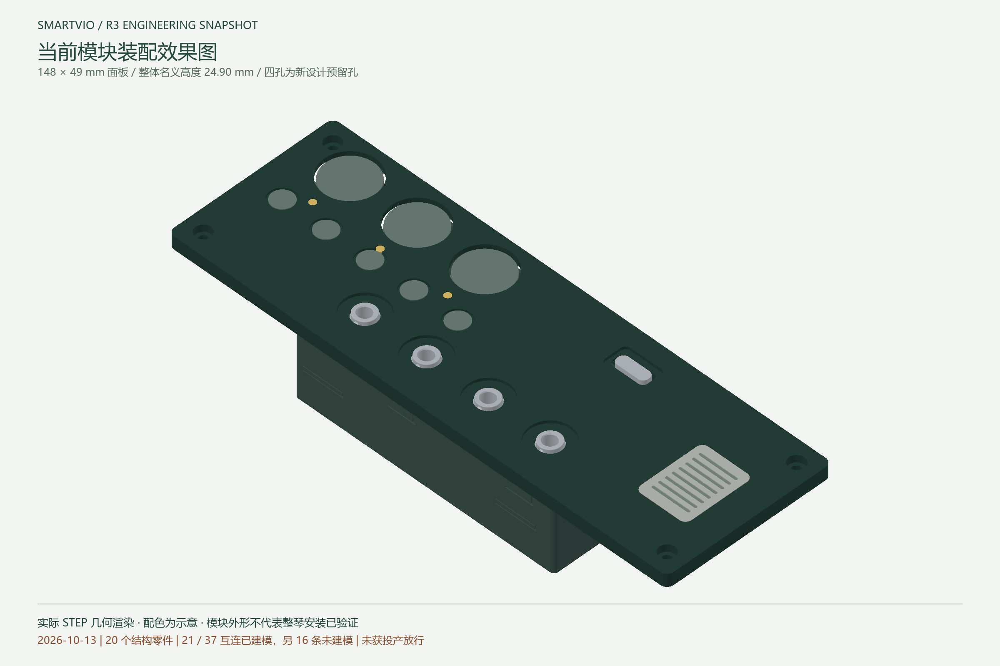

# SmartVio 全资料分类归档 · 2026-10-15

本区保存本轮截取的 **9,283 个项目文件**，内容去重后 4,226 份；恢复时保留各版本原来的路径与文件名。现有仓库 `checkpoints/`、`CLOUD_HANDOFF.md`、`CHECKPOINT_CURRENT.txt` 和 `README.md` 均保持原样。

## 先打开

- [R3 当前方案与缺项清单](current-engineering/r3-view/reports/SmartVio-R3-当前方案与缺项清单.pdf)
- [机械图与装配效果图](current-engineering/r3-view/drawings/M-R3-机械图与装配效果图.pdf)
- [24页原理图](current-engineering/r3-view/drawings/E-R3-24页当前原理图.pdf)
- [PCB / FPC审查图](current-engineering/r3-view/drawings/E-R3-PCB与FPC审查图.pdf)
- [测试工作簿与候选BOM](current-engineering/r3-view/reports/SmartVio-R3-首样工作测试与候选BOM.xlsx)
- [本轮捕获的移动Web源码](current-software/mobile/)（package版本0.16.0；153文件固定快照）
- [仓库随后新增的V16软件完整检查点](../../checkpoints/2026-10-15-app-v16-6f461b9612ac/)（冻结提交6f461b9612ac，166文件；与本归档同时保留）
- [全部文件目录与SHA256](FILE-MANIFEST.json)
- [过滤与归档净化记录](audit/ARCHIVE-SANITIZATION.json)
- [全量恢复验收报告](audit/RESTORATION-QA.json)



## 分类原则

| 恢复后的分区 | 文件数 |
|---|---:|
| active-software/artifacts-history | 1521 |
| active-software/mobile | 153 |
| current/r3-delivery | 3 |
| current/r3-working | 1155 |
| current/reproduction-scripts | 23 |
| history/concept-renders | 2 |
| history/engineering | 3295 |
| history/reorganized-r3-copy | 2847 |
| history/software-v11 | 106 |
| history/software-v12 | 178 |

`current/r3-delivery` 是10月13日原完整R3交付ZIP及校验记录，原ZIP SHA仍为 `d0ec6331d4b88b9c7c2a80528609e6f0f7621eafb7953d97fb55bfcd11a7381a`。

`current/r3-working` 保留R3工作源及历史候选，选板以 `project/selected-boards.json` 的文件SHA为准，不能按文件更新时间选用失败候选。

仓库在本次上传准备期间新增了V16检查点（`checkpoints/2026-10-15-app-v16-6f461b9612ac/`）。软件恢复优先查看该目录的166文件冻结源码与校验记录；本区153文件保留本轮更早捕获的状态，二者不互相覆盖。

`active-software/mobile` 是独立的软件后续分支，不等于R3随包Web V12，也不代表与R3实体硬件完成联调。`active-software/artifacts-history` 保存软件效果图、研究、测试/审计与阶段资料。本轮仅做归档/完整性检查，未重新执行或批准产品功能。

`history/reorganized-r3-copy` 保存用户后来整理成编号文件夹的R3解压目录。其布局与原1,418文件交付ZIP不同，二者均保留，未互相覆盖。

其他 `history/` 保存R1/R2、V11/V12及概念效果图；历史模拟读数、旧测试和失败板件不作为现行合格证据。

## 下载与恢复全部资料

GitHub中可直接浏览上述主要图纸和最新移动Web代码。完整源码、STEP、图片、固件产物、日志、审核资料和历史包采用可校验分块归档，避免把相同内容反复存储。

1. 下载整个仓库ZIP并解压，或克隆仓库；只下载本README无法恢复全部资料。
2. 进入本目录，Windows双击 `恢复全部资料.cmd`。需Python 3.9+；脚本优先使用已安装的E盘Python。
3. 默认恢复到 `E:\codex\SmartVio-GitHub恢复-20261015`，临时文件在 `E:\codex\Temp`。已有非空目标目录不会被覆盖。

也可执行：

```powershell
python restore.py --verify-only
python restore.py --target E:/codex/SmartVio-GitHub恢复-20261015
```

归档包含 213 个二进制分块，总压缩大小 889,232,166 bytes。`restore.py`先校验每块SHA、合并ZIP的SHA、全部对象SHA，再恢复每个文件并再次核对。脚本不联网、不执行任何项目代码或固件。

## 上传范围与核查边界

本轮纳入本机SmartVio命名工程/交付文件、R3复现脚本、`sites/smartvio-mobile`及`sites/artifacts`。无关亚马逊商品图片/竞品调查、第三方工具安装目录、Git元数据、依赖缓存、构建临时对象、账号数据库与凭据不属于上传内容。

20个历史软件归档中发现 `.openai` 本地部署状态；上传副本已递归移除101条成员路径，原件仍保留本地。其余25个归档（含工程ZIP）保持原字节。实际凭据格式扫描未命中；此结论仅限已声明扫描范围。净化后的归档与原件SHA差异记录在审计目录。

文件捕获期间其他软件工作仍有更新。本包采用 `FILE-MANIFEST.json` 中的固定字节与捕获时间；盘点后变化记录在 `audit/SOURCE-CAPTURE.json`，不声称后续修改自动同步。

## 工程状态

R3主板未连接0；五块板与四组FPC原生检查通过；20件STEP有效。仍缺16条完整互连路线、四弦独立拾音及配套代码、供应商DFM回签和实物测试。正常充电HOLD，制造放行false。归档完整不等于整机合格。

旧根目录 `CHECKPOINT_CURRENT.txt` 仍指向10月8日V26历史快照；本次新资料以本README和清单为入口，不更改旧文档的历史含义。
